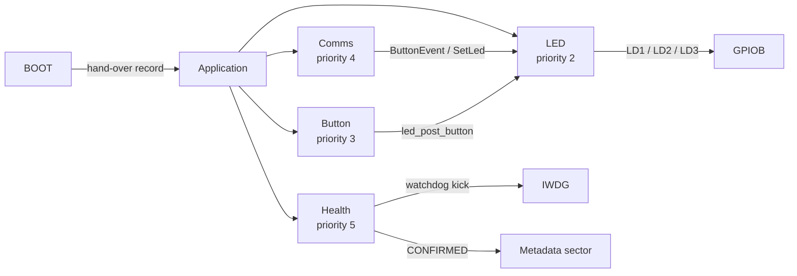
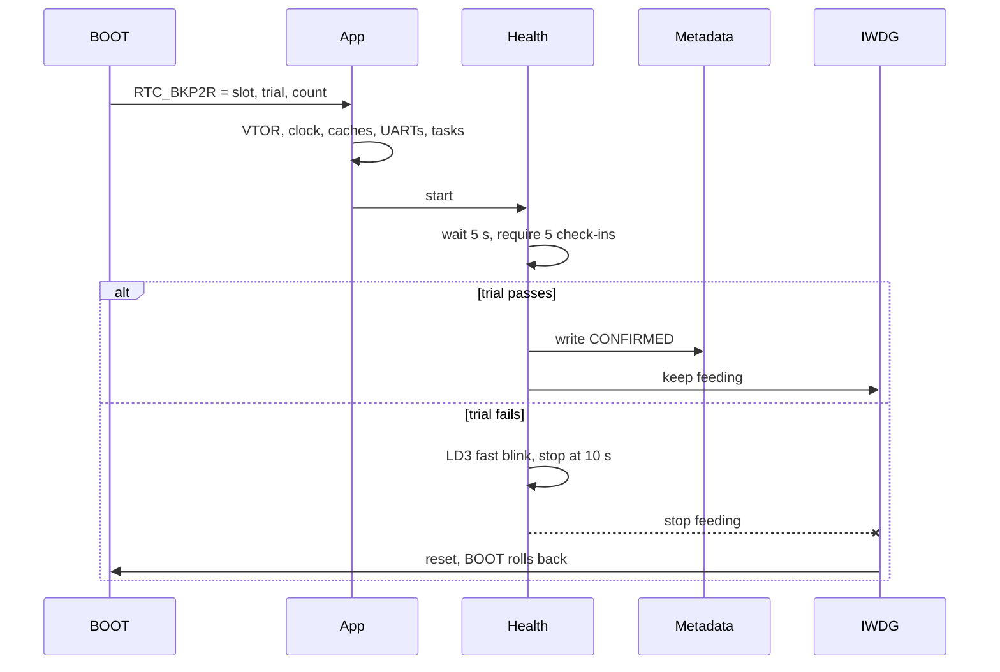
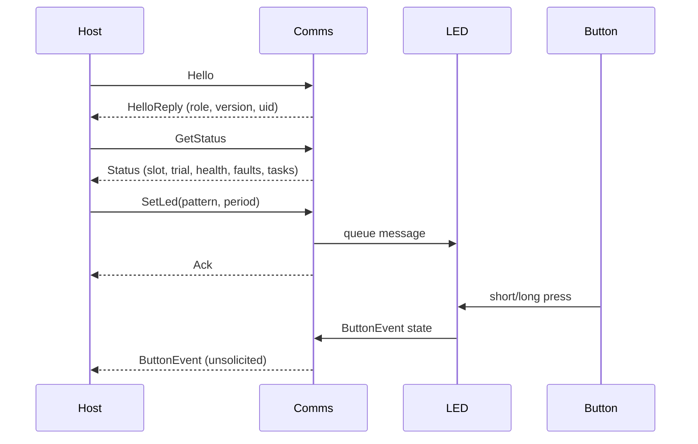

# Architecture

This page describes how the pieces of `app-c-freertos` fit together: the
task model, the flash memory map, the hand-over from the bootloader and the
HWLINK message flow. The API-level documentation is generated by Doxygen from
the source comments; this page is the map that tells you where to look.

## Design in one paragraph

BOOT starts the image from slot A or B with the bank swapped so that the image
always runs at `0x0800C000`. The application brings up the clock, caches,
debug UART and HWLINK UART, creates four FreeRTOS tasks and then starts the
scheduler. The Health task is the only watchdog feeder and the only task that
writes the `CONFIRMED` record; the other three tasks check in with it. The LED
task is the only writer of the three LED pins, the Button task owns B1 and its
EXTI line, and the Comms task owns USART3 and the HWLINK protocol. Everything
is statically allocated before the scheduler starts.

## Task model

| Task | Priority | Stack | Period / trigger | Owns | Checks in with Health |
|---|---:|---:|---|---|---|
| Health | `tskIDLE_PRIORITY + 5` | 384 words | 20 ms loop, watchdog every 100 ms | IWDG, health state, `CONFIRMED` record | itself |
| Comms | `tskIDLE_PRIORITY + 4` | 768 words | UART RX / queues | USART3, HWLINK framing and FlatBuffers | every 500 ms |
| Button | `tskIDLE_PRIORITY + 3` | 384 words | EXTI13, 10 ms sample | B1 / PC13, debounce and press classification | every 500 ms |
| LED | `tskIDLE_PRIORITY + 2` | 384 words | next pattern edge, ≤500 ms | LD1/LD2/LD3 pins, pattern state | every 500 ms |

The Health task supervises the other three and itself. It treats a task as
late when a check-in is more than 2 s old, requires five check-ins before the
trial health check at 5 s, and fails the check when the free heap drops below
4 KB. A failed trial stops the watchdog after 10 s so BOOT can roll back. A
normal trial writes the `CONFIRMED` record at `0x08008140` and lets BOOT keep
the image.



## Flash and RAM map

The STM32F767ZI has two 1 MB flash banks. BOOT keeps the same layout in each
bank and swaps the banks so the running image is always mapped at
`0x08000000`.

| Address | Size | Use |
|---|---:|---|
| `0x08000000` | 32 KB | BOOT, sectors 0..1 |
| `0x08008000` | 16 KB | metadata sector, slot A |
| `0x0800C000` | 976 KB | application slot A / running image |
| `0x08100000` | 32 KB | BOOT mirror in bank 2 |
| `0x08108000` | 16 KB | metadata sector, slot B |
| `0x0810C000` | 976 KB | application slot B |

Within the metadata sector the application writes only the 32-byte
`CONFIRMED` record at offset `0x140`, i.e. `0x08008140` for the running slot.
Every other offset is BOOT-owned; the boot-contract CI stage compares the
constants in `src/services/boot_contract.h` with this table.

RAM is split so the fault record survives a reset:

| Address | Size | Use |
|---|---:|---|
| `0x20000000` | 127 KB | DTCM RAM, main stack and fast data |
| `0x2001FC00` | 1 KB | no-init window, fault record at the top |
| `0x20020000` | 368 KB | SRAM1, FreeRTOS heap and static data |
| `0x2007C000` | 16 KB | SRAM2, DMA-safe buffers |

The linker script asserts the slot origin, the no-init window and the SRAM2
DMA buffer size, so a wrong layout fails the build instead of the board.

## Boot hand-over

1. BOOT verifies the image header and metadata and maps the active bank.
2. BOOT writes the hand-over word to `RTC_BKP2R`: magic `0x444E48`, slot,
   trial-pending bit and trial counter.
3. BOOT jumps to the image entry point.
4. `main()` sets `SCB->VTOR`, kicks the watchdog early, captures the reset
   cause and brings up the clock, caches and fault handlers.
5. `app_handover_read()` decodes `RTC_BKP2R` into `g_handover`. A missing or
   bad record means "started without BOOT": the slot is unknown and no
   confirmation is attempted.
6. The Health task starts the trial check when the record says the slot is
   pending. On success it writes `CONFIRMED`; on failure it stops feeding the
   watchdog so the board resets and BOOT counts the failed trial.

The `EnterBootloader` command does not reset by itself. It writes the
"stay in BOOT" magic to `RTC_BKP1R`, sends the Ack and then resets through the
normal command path; BOOT sees the magic and stays in update mode.



## HWLINK flow

HWLINK is a binary request/response protocol with unsolicited events. A raw
frame is:

```text
proto[1] flags[1] seq[2] payload[n] crc32[4]
```

The CRC is CRC-32/ISO-HDLC over the header and payload. The frame is
COBS-encoded and terminated by one `0x00` delimiter, so the receiver can
resynchronise after corruption. Frames with a bad CRC, a wrong major version
or reserved flags are dropped silently; they are never answered with a NAK,
so a noisy link cannot turn into a NAK storm. The payload is a FlatBuffers
document generated from the shared `protocol/hwlink.fbs`.



The Comms task keeps the last reply so a repeated sequence number is answered
with the cached reply instead of executing the command twice. Host requests
that the build does not support are answered with `Nak(UNSUPPORTED)`; invalid
arguments get `Nak(BAD_ARGUMENT)`; a full LED queue gets `Nak(BUSY)`.

## Start-up order

The order in `main()` is contractual and is covered by the boot-contract
comments in the source:

1. `SCB->VTOR = APP_SLOT_BASE`, early IWDG kick, fault boot counter.
2. Capture the reset cause before the HAL can disturb it.
3. `HAL_Init`, clock tree to 216 MHz, I-cache/D-cache and MPU.
4. Enable MemManage, BusFault and UsageFault.
5. Read the BOOT hand-over word.
6. Start the debug log and the LEDs.
7. Read or start the IWDG, latch a previous fault and watchdog reset.
8. Start USART3.
9. Create the LED, Button, Comms and Health tasks, Health last.
10. `vTaskStartScheduler()`.

Nothing allocates after step 9. Every `malloc`/`free` match in the tree is a
comment; the FreeRTOS heap is used only by the task and queue creation calls
before the scheduler starts.

## Where to look

| Topic | Source |
|---|---|
| Boot contract and memory map | `src/services/boot_contract.h` |
| Hand-over record | `src/app/handover.c`, `src/app/handover.h` |
| Start-up order | `src/app/main.c` |
| Health, watchdog and confirmation | `src/tasks/health_task.c` |
| HWLINK framing | `src/protocol/hwlink.c`, `src/protocol/hwlink.h` |
| HWLINK commands | `src/tasks/comms_task.c` |
| LED pattern engine | `src/tasks/led_task.c` |
| Button debounce | `src/tasks/button_task.c` |
| Fault record | `src/services/app_fault.c` |
| Host tests | `tests/host/` |
| Boot contract check | `scripts/check_boot_contract.py` |
